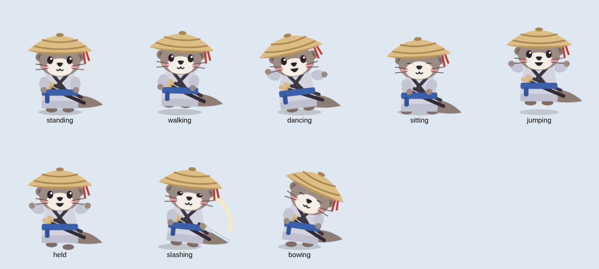
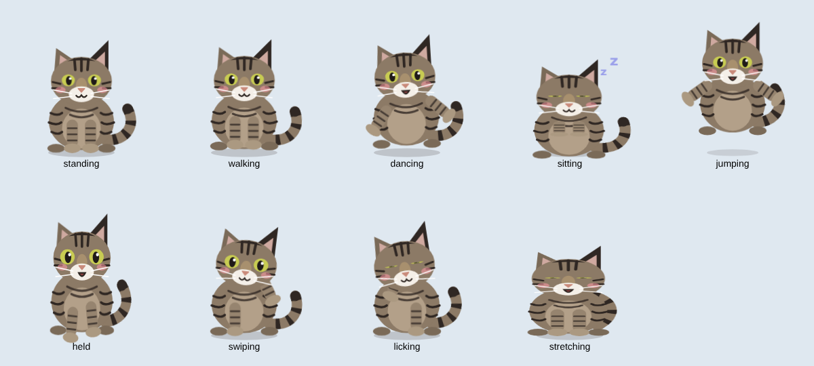

# Pomo 🦦🐱

A cute pomodoro timer for Windows and Mac. A little animated buddy keeps you company while you work: wandering around when you're idle, settling down quietly while you focus, and dancing when it's break time. It also has a to-do list and can play and pause your Spotify for you.

<p></p>
<p></p>
<p></p>

## Contents

- [Install on Windows](#install-on-windows)
- [Install on Mac](#install-on-mac)
- [Getting a newer version](#getting-a-newer-version)
- [Using Pomo](#using-pomo)
- [Set up Spotify](#set-up-spotify-optional)
- [Always-latest mode](#always-latest-mode-optional)
- [If something isn't working](#if-something-isnt-working)
- [For tinkering](#for-tinkering)

## Install on Windows

1. Sign in to GitHub (this repo is private, so the download page only shows for you).
2. Open the **[latest release](https://github.com/amlkong/pomodoro/releases/latest)**.
3. Under **Assets**, click `Pomo-Setup-x.x.x.exe` to download it.
4. Double-click the downloaded file.
5. If a blue "Windows protected your PC" box appears, click **More info**, then **Run anyway**. It shows up because the app isn't signed with a paid Microsoft certificate, which is normal for personal apps.

That's it. Pomo opens by itself, and from now on you start it from the **Pomo icon on your desktop** or from the Start menu.

## Install on Mac

1. Sign in to GitHub and open the **[latest release](https://github.com/amlkong/pomodoro/releases/latest)**.
2. Under **Assets**, download the `.dmg`: `arm64` for Apple Silicon (M1/M2/M3/M4), `x64` for older Intel Macs. Apple menu → About This Mac tells you which you have.
3. Open the `.dmg` and drag Pomo into Applications.
4. In Applications, right-click Pomo and choose **Open**, then **Open** again.
5. If it still won't open: System Settings → Privacy & Security → scroll down → **Open Anyway**.

## Getting a newer version

Every change to this repo automatically publishes a new release with fresh installers.

1. Open the **[latest release](https://github.com/amlkong/pomodoro/releases/latest)**.
2. Download and run the new installer, same as the first time.

It installs over the old one. Your settings, to-do list and Spotify connection are kept, and your desktop icon keeps working.

If you'd rather not download anything for each update, see [Always-latest mode](#always-latest-mode-optional).

## Using Pomo

### The timer

- **Start / Pause / Resume**: the big button, or press the space bar.
- **↺** resets the current round. **⏭** skips to the next one.
- **Focus / Short break / Long break** tabs jump straight to that kind of round.
- The dots show how many focus rounds you've done toward the next long break.
- A desktop notification pops up when a round ends.
- **⚙** opens settings: how long each round is, how many rounds before a long break, whether the next round starts by itself, and Spotify.

### The to-do list

- Type a task under the timer and press **Enter**.
- Tick the box when it's done. Your buddy celebrates.
- Hover a task and click **×** to remove it, or **clear done** to sweep away the finished ones.
- The list is saved, so it's still there next time you open the app.

### Your buddy

Two buttons at the top of the window control the character:

- **⇄ switches character.** Right now there are two:
  - 🦦 **Pomo**, a samurai otter. Practices sword moves, bows, and meditates while you focus.
  - 🐱 **Tabby**, a happy tabby cat. Bats at things, washes a paw, stretches, and naps in a loaf while you focus.
- **The pill next to it chooses where they live.** Click to cycle:
  - **whole screen**: walks along the bottom of your screen, on top of your other windows. Your clicks pass straight through to whatever is underneath.
  - **in window**: stays inside the timer window on a little floor.
  - **hidden**: goes away until you click again.

Click your buddy for a little hello. You can also pick them up with the mouse, carry them anywhere, and drop them.

## Set up Spotify (optional)

Pomo works like a remote control for the Spotify app you already have open: it presses play when you start focusing and pause on breaks. You need **Spotify Premium** (Spotify only allows remote control on Premium) and this one-time setup, about five minutes:

1. Go to [developer.spotify.com/dashboard](https://developer.spotify.com/dashboard) and log in with your normal Spotify account.
2. Click **Create app**. Any name and description are fine, for example "Pomo".
3. In **Redirect URIs**, paste this exactly and click **Add**:
   ```
   http://127.0.0.1:8888/callback
   ```
4. If it asks which API you're planning to use, tick **Web API**. Save.
5. Open your new app's **Settings** and copy the **Client ID**.
6. In Pomo, click **⚙** and paste the Client ID into the Spotify box.
7. Optional: paste a link to a focus playlist in the box below it (in Spotify: Share → Copy link to playlist). Pomo starts that playlist on your first focus round. Searching Spotify for "deep focus" or "binaural beats focus" turns up good ones.
8. Click **Connect Spotify**, then log in and click **Agree** on the page that opens in your browser.

Day to day: keep the Spotify app open on your computer or phone. Start a focus round and the music plays; breaks pause it. If you'd like music during breaks too, turn on **Keep music on during breaks** in ⚙.

## Always-latest mode (optional)

This is for when you're changing the app often and don't want to download an installer each time. You keep a copy of the code on your computer and open Pomo with a launcher that fetches the newest version every time it starts.

### One-time setup (Windows)

1. Install [Node.js](https://nodejs.org) (the **LTS** version). Click through the installer with the default options.
2. Install [Git for Windows](https://git-scm.com/downloads/win), also with the default options.
3. Open **Command Prompt** (press the Windows key, type `cmd`, press Enter) and run:
   ```
   git clone https://github.com/amlkong/pomodoro.git
   ```
   A GitHub sign-in window pops up the first time because the repo is private. Sign in and it continues. This creates a `pomodoro` folder inside your user folder (`C:\Users\<you>\pomodoro`).
4. Open that folder and double-click **`make-desktop-shortcut.bat`**. It puts a **Pomo (latest)** icon on your desktop.

From then on, double-click **Pomo (latest)** on your desktop. A small helper window opens minimized in the taskbar, checks for updates, and starts Pomo. The very first start takes a minute or two.

### One-time setup (Mac)

1. Install [Node.js](https://nodejs.org) (the **LTS** version).
2. Open **Terminal** and run `git clone https://github.com/amlkong/pomodoro.git`, signing in to GitHub when asked.
3. From then on, double-click **`start-mac.command`** in the `pomodoro` folder. The first time, right-click it and choose **Open**.

Good to know: in this mode, a helper window stays open while Pomo runs. Closing it closes Pomo. The installed version doesn't have that, so it's the nicer one for everyday use.

## If something isn't working

**`start-windows.bat` opens and closes, or does nothing.** It now stays open and tells you what's wrong. The usual causes:
- *"Pomo needs Node.js"*: install Node.js from [nodejs.org](https://nodejs.org), then try again.
- *"This file only works from inside the whole pomodoro folder"*: the file was downloaded by itself. You need the whole project (step 3 of always-latest mode).
- *"Could not check for updates"*: Git isn't signed in to GitHub, or you're offline. Pomo still opens with the version you have.

**Windows says "Windows protected your PC".** Click **More info** → **Run anyway**.

**Mac says the app can't be opened.** Right-click → **Open**, or System Settings → Privacy & Security → **Open Anyway**.

**Spotify says "Open Spotify and play something once".** Spotify needs an active device. Play any song for a second in the Spotify app, then start your focus round again.

**Spotify connect fails with a redirect error.** The Redirect URI in the Spotify dashboard has to match exactly: `http://127.0.0.1:8888/callback`

**The character isn't showing.** Click the pill at the top of the window until it says **whole screen** or **in window**.

**I can't see the releases page.** Make sure you're signed in to the GitHub account that owns this repo.

## For tinkering

Run it from the code:

```bash
npm install
npm start
```

Build an installer for the computer you're on (lands in `dist/`):

```bash
npm run dist
```

### Adding a character

Each character is two files in `src/characters/`:

- `name.js`: the drawing (an SVG), its name and emoji, what it says, and its extra moves
- `name.css`: the animations for each pose

Every character needs these poses: `walking`, `dancing`, `sitting` (focus time), `jumping` (celebrating) and `held` (picked up). On top of that it can have its own extras, listed in `idleActions` and `breakActions`, like the otter's `slashing` or the cat's `licking`.

To add one, copy `cat.js` and `cat.css`, change the drawing and animations, then add the two files to both `src/timer/index.html` and `src/pet/pet.html` next to the existing ones. The ⇄ button picks it up automatically.

### Project layout

```
src/main.js          timer logic, windows, to-do storage, music control
src/spotify.js       Spotify login and play/pause
src/characters/      one .js and one .css per character
src/pet/             how a character behaves (shared by the screen overlay and the timer window)
src/timer/           the timer window
build/               app icon and installer helpers
start-windows.bat    always-latest launcher for Windows
start-mac.command    always-latest launcher for Mac
```
