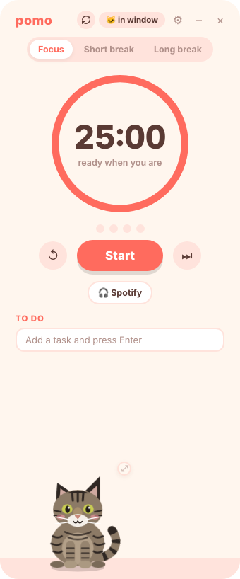
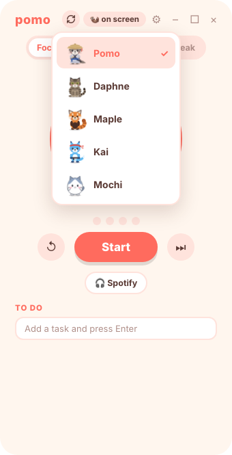
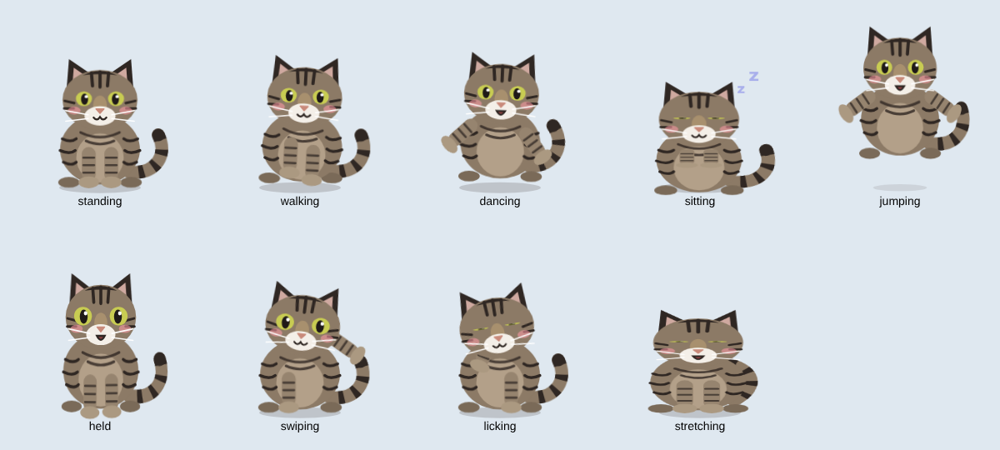
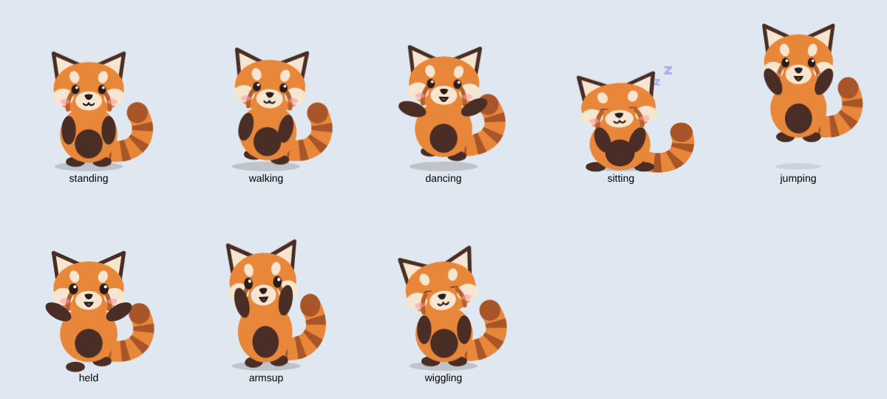

# Pomo 🦦🐱

A cute pomodoro timer for Windows and Mac. A little animated buddy keeps you company while you work: wandering around when you're idle, settling down quietly while you focus, and dancing when it's break time. It also has a to-do list and can play and pause your Spotify for you.

<p> </p>
<p></p>
<p></p>
<p></p>
<p></p>
<p></p>

## Contents

- [Install on Windows](#install-on-windows)
- [Install on Mac](#install-on-mac)
- [Getting a newer version](#getting-a-newer-version)
- [Using Pomo](#using-pomo)
- [Set up Spotify](#set-up-spotify-optional)
- [Connect Todoist, Notion and Google Calendar](#connect-todoist-notion-and-google-calendar-optional)
- [Always-latest mode](#always-latest-mode-optional)
- [If something isn't working](#if-something-isnt-working)
- [For tinkering](#for-tinkering)

## Install on Windows

1. Open the **[latest release](https://github.com/amlkong/pomodoro/releases/latest)**.
2. Under **Assets**, click `Pomo-Setup-x.x.x.exe` to download it.
3. Double-click the downloaded file.
4. If a blue "Windows protected your PC" box appears, click **More info**, then **Run anyway**. It shows up because the app isn't signed with a paid Microsoft certificate, which is normal for personal apps.

That's it. Pomo opens by itself, and from now on you start it from the **Pomo icon on your desktop** or from the Start menu. You only do this once: after that, Pomo keeps itself up to date.

## Install on Mac

1. Open the **[latest release](https://github.com/amlkong/pomodoro/releases/latest)**.
2. Under **Assets**, download the `.dmg`: `arm64` for Apple Silicon (M1/M2/M3/M4), `x64` for older Intel Macs. Apple menu → About This Mac tells you which you have. The Mac files are added a few minutes after the Windows one, so if a brand-new release doesn't list a `.dmg` yet, check back shortly or pick the previous release.
3. Open the `.dmg` and drag Pomo into Applications.
4. In Applications, right-click Pomo and choose **Open**, then **Open** again.
5. If it still won't open: System Settings → Privacy & Security → scroll down → **Open Anyway**.

## Getting a newer version

Every change to this repo automatically publishes a new release.

**Windows: nothing to do.** Just open Pomo from its desktop icon. Each time it opens, it checks for a newer version. If there is one, a pill at the top says **✨ Getting version x.x.x…**, and a few seconds later Pomo restarts itself into the new version. So double-clicking the icon always lands you on the latest one.

If an update arrives while you're in the middle of a round, Pomo doesn't interrupt you. The pill changes to **✨ Version x.x.x is ready · restart**. Click it when you like, or ignore it and the new version is there next time you open Pomo.

**Mac:** the pill says **✨ Version x.x.x is out · download** and takes you to the download page. Install the new `.dmg` the same way as the first time. (Apple only allows silent updates for apps signed with a paid developer certificate.)

Either way, your settings, to-do list and Spotify connection are kept.

## Using Pomo

### The timer

- **Start / Pause / Resume**: the big button, or press the space bar.
- **↺** resets the current round. **⏭** skips to the next one.
- **Focus / Short break / Long break** tabs jump straight to that kind of round.
- The dots show how many focus rounds you've done toward the next long break.
- When a round ends, a soft chime plays and a desktop notification pops up. You can turn the chime off in ⚙ (**Alarm sound when a round ends**).
- **□** at the top right makes the window fill the screen, with everything bigger. Click it again to go back to the small window.
- **Drag the bottom-right corner** to make the window any size you like, which gives the lists more room. Pomo remembers the size. Double-click the corner to go back to the standard size.
- **⚙** opens settings: how long each round is, how many rounds before a long break, whether the next round starts by itself, and Spotify.

### The to-do list

- Type a task under the timer and press **Enter**.
- Tick the box when it's done. Your buddy celebrates.
- Hover a task and click **×** to remove it, or **clear done** to sweep away the finished ones.
- The list is saved, so it's still there next time you open the app.

### Your buddy

Two buttons at the top of the window control the character:

- **The round arrows button opens the character menu.** Pick whoever you like:
  - 🦦 **Pomo**, a samurai otter. Practices sword moves, bows, and meditates while you focus.
  - 🐱 **Daphne**, a happy tabby cat. Bats at things, washes a paw, stretches, and naps in a loaf while you focus.
  - 🍁 **Maple**, a red panda. Does the famous arms-up "I'm very scary" pose, wiggles, and curls up asleep while you focus.
  - 🐺 **Ash**, a fluffy grey wolf pup. Throws his head back and howls, wiggles down and pounces, and curls up asleep while you focus.
  - 🐰 **Aki**, a lop-eared bunny. Stands up on his back legs for a look around, munches a leafy treat, does binkies, and loafs asleep while you focus.
- **The pill next to it chooses where they live.** Click to cycle:
  - **on screen**: walks along the bottom of your screen, on top of your other windows. Your clicks pass straight through to whatever is underneath.
  - **in window**: stays inside the timer window on a little floor.
  - **hidden**: goes away until you click again.

During a focus round your buddy settles down quietly, then every five minutes or so gets up, wanders to a new spot, and settles again.

Click your buddy for a little hello. You can also pick them up with the mouse, carry them anywhere, and drop them.

**Changing their size:** hover over your buddy and a small round handle appears at the top corner. Drag it up to make them bigger, down to make them smaller. There's also a **Character size** slider in ⚙. The size is remembered.

## Set up Spotify (optional)

Pomo works like a remote control for the Spotify app you already have open: it presses play when you start focusing and pause on breaks. You need **Spotify Premium** (Spotify only allows remote control on Premium) and this one-time setup, about five minutes:

1. Go to [developer.spotify.com/dashboard](https://developer.spotify.com/dashboard) and log in with your normal Spotify account.
2. Click **Create app**. Any name and description are fine, for example "Pomo".
3. In **Redirect URIs**, paste this exactly and click **Add**:
   ```
   http://127.0.0.1:8888/callback
   ```
4. If it asks which API you're planning to use, tick **Web API**. Save.
5. Open your new app's **Settings** and copy the **Client ID**.
6. In Pomo, click **⚙** and paste the Client ID into the Spotify box.
7. Optional: paste a link to a focus playlist in the box below it (in Spotify: Share → Copy link to playlist). Pomo starts that playlist on your first focus round. Searching Spotify for "deep focus" or "binaural beats focus" turns up good ones.
8. Click **Connect Spotify**, then log in and click **Agree** on the page that opens in your browser.

Day to day, you don't need to touch Spotify first. Press **Start** on a focus round and Pomo takes care of it:

- If Spotify is already playing, it carries on.
- If Spotify is open but idle, Pomo wakes it up and starts the music. No need to press play there first.
- If Spotify is closed, Pomo opens the Spotify app, waits for it, and starts your playlist. This takes a few seconds, and the line under the buttons says **Opening Spotify…** while it happens.

Breaks pause the music. The **🎧 Spotify** button on the main screen does the same thing on demand: it opens Spotify and starts the music right away, without starting the timer.

For the closed-Spotify case, paste a playlist link in ⚙ (step 7). A freshly opened Spotify has nothing queued, so Pomo needs to know what to play. If you'd like music during breaks too, turn on **Keep music on during breaks** in ⚙.

## Connect Todoist, Notion and Google Calendar (optional)

If you keep your tasks in Todoist or Notion, or your day in Google Calendar, Pomo can show them in tabs next to the to-do list. You look through them there and click **+** on the ones you want to work on this session, which copies them into your Pomo to-do list.

There are two extra tabs:

- **Tasks** shows either Todoist or Notion. A small dropdown at the top of the tab picks which one, and Pomo remembers your choice, so you only set it once.
- **Calendar** shows your events for today or the coming week.

Out of the box everything is read-only: Pomo never changes anything in Todoist, Notion or your calendar. If you want Pomo to be the one place you manage your day, you can let it make changes too:

- **Todoist:** complete, add and delete tasks (one switch in ⚙)
- **Google Calendar:** add and delete events, and log your focus rounds (by signing in with Google)

Both are described below. Anything that deletes always asks "are you sure?" first.

### Todoist

1. In Todoist, open **Settings → Integrations → Developer**.
2. Copy your **API token**.
3. In Pomo, click **⚙**. Under **Task lists**, set **I keep my tasks in** to **Todoist** and paste the token into **Todoist API token**.

Open the **Tasks** tab. It starts on what's overdue and due today. Click **today** to switch to all your open tasks, and **↻** to refresh.

**Changing Todoist from Pomo.** In ⚙, turn on **Let Pomo change Todoist**. Then, in the **Tasks** tab:

- **Add a task:** type it in the box at the top and press Enter. It goes to your Todoist Inbox.
- **Complete a task:** click the round ✓ on its row. A task you picked into your to-do list (it carries a small "Todoist" tag) is also completed in Todoist when you tick it in Pomo, and reopened there if you untick it.
- **Delete a task:** hover the row and click **×**, then **Delete**. This removes it from Todoist for good, and Todoist has no undo for that, so for finished work completing is usually the better choice.

With the switch off, Pomo only reads your tasks. Tasks you typed into Pomo's own to-do list are never sent to Todoist.

### Notion

1. Go to [notion.so/profile/integrations](https://www.notion.so/profile/integrations) and click **New integration**. Name it "Pomo", pick your workspace, and save. Read access is all it needs.
2. Copy the **Internal Integration Secret**.
3. In Notion, open the page or database that holds your tasks. Click **•••** at the top right → **Connections** → add your "Pomo" integration. Notion only lets an integration see pages you've shared with it this way.
4. Copy the link to that page (**Share → Copy link**).
5. In Pomo, click **⚙**. Under **Task lists**, set **I keep my tasks in** to **Notion**, then paste the secret into **Notion integration secret** and the link into **Notion page or database link**.

Open the **Tasks** tab. It works with either kind of page:

- a **database** (a table or board of tasks): each row is a task, and rows that are checked off or have a status like Done are left out
- a **regular page** with to-do checkboxes: each unchecked box is a task

Notion is read-only in Pomo: ticking a task here doesn't change the Notion page.

### Google Calendar

There are two ways to connect, and you can use either or both.

| | Private link | Sign in with Google |
| --- | --- | --- |
| See your events | ✓ | ✓ |
| Add events from Pomo | | ✓ |
| Delete events from Pomo | | ✓ |
| Log focus rounds to your calendar | | ✓ |
| Setup | one copy and paste | about 15 minutes, once |

If you sign in with Google, Pomo uses that. The private link is the simple read-only option.

#### Option 1: private link (read-only)

1. On a computer, open [calendar.google.com](https://calendar.google.com).
2. Click the **gear** at the top right → **Settings**.
3. In the left sidebar, under **Settings for my calendars**, click the calendar you want.
4. Scroll to **Integrate calendar** and copy the **Secret address in iCal format**. It ends in `basic.ics`. (Not the "Public address" just above it.)
5. In Pomo, click **⚙**, scroll to **Calendar**, and paste it into **Or read-only: private link**.

Treat that link like a password: anyone who has it can read that calendar. If it ever gets out, Google's **Reset** button next to it makes a new one. School and work Google accounts sometimes have this link switched off by an administrator. The same box accepts the private iCal link from Outlook or iCloud calendars too.

#### Option 2: sign in with Google (add and delete events)

Google requires every app that changes a calendar to be registered with them. Pomo is a personal app, so you register your own free copy. It's a one-time job of about 15 minutes.

**Part A: create your Google project**

1. Go to [console.cloud.google.com](https://console.cloud.google.com) and sign in with the Google account whose calendar you use.
2. At the top, click the project dropdown → **New project**. Name it "Pomo" and click **Create**. Make sure it's selected afterwards.
3. In the search bar at the top, type **Google Calendar API**, open it, and click **Enable**.

**Part B: the consent screen**

4. In the left menu go to **APIs & Services → OAuth consent screen** (Google sometimes labels this area **Google Auth Platform**). Click **Get started**.
5. App name: "Pomo". Support email: your email. Audience: **External**. Contact email: your email. Agree and **Create**.
6. Open **Audience** in that area's menu. Under **Publishing status**, click **Publish app** and confirm, so it says **In production**. This matters: if you leave it on "Testing", Google signs Pomo out every 7 days.

**Part C: your sign-in ID**

7. Open **Clients** (or **Credentials → Create credentials → OAuth client ID**).
8. Application type: **Desktop app**. Name: "Pomo". Click **Create**.
9. Copy the **Client ID** and the **Client secret** that it shows.

**Part D: connect Pomo**

10. In Pomo, click **⚙** and scroll to **Calendar**.
11. Paste the Client ID into **Google Client ID** and the secret into **Google Client secret**.
12. Click **Sign in with Google**. Your browser opens.
13. Pick your account. Google shows **"Google hasn't verified this app"**. That's expected for a personal app: click **Advanced**, then **Go to Pomo (unsafe)**. It says "unsafe" only because Google hasn't reviewed it, and the app is the one you just registered yourself.
14. Tick the box allowing Pomo to **view and edit events on all your calendars**, and click **Continue**.
15. The page says Pomo is connected, and you can close the tab.

**Using it.** In the **Calendar** tab:

- **Add an event:** type it in the box at the top in plain words and press Enter, for example `Dentist tomorrow 3pm` or `Lunch with Sam Friday 12:30`. Google works out the date and time. With no time given, it starts now.
- **Delete an event:** hover the row and click **×**, then **Delete**. For a repeating event this removes only that one occurrence.
- **Log your focus rounds:** in ⚙, turn on **Log finished focus rounds to my calendar**. Each focus round you finish is added to your calendar as "Focus session 🍅" with its real start and end time, so your calendar becomes a record of your day.

Pomo works with your main calendar. It asks Google only for permission to read and change events, not your calendar settings or sharing. Click **Sign out of Google** in ⚙ at any time, and you can remove Pomo's access completely at [myaccount.google.com/permissions](https://myaccount.google.com/permissions).

### Good to know

- Your tokens, calendar link and Google sign-in are saved on your computer only, encrypted by Windows or macOS, and are never shown again after you paste them. Click **disconnect** next to a field to remove one.
- A task you've already added shows a ✓ instead of a +.
- Lists refresh when you open the tab, at most every two minutes. Click **↻** to refresh right away.
- **↗** opens Todoist, your Notion page or Google Calendar in your browser.

## Always-latest mode (optional)

On Windows the installed app already updates itself, so most people can skip this. It's here for Mac, or for running straight from the code. You keep a copy of the code on your computer and open Pomo with a launcher that fetches the newest version every time it starts.

### One-time setup (Windows)

1. Install [Node.js](https://nodejs.org) (the **LTS** version). Click through the installer with the default options.
2. Install [Git for Windows](https://git-scm.com/downloads/win), also with the default options.
3. Open **Command Prompt** (press the Windows key, type `cmd`, press Enter) and run:
   ```
   git clone https://github.com/amlkong/pomodoro.git
   ```
   This creates a `pomodoro` folder inside your user folder (`C:\Users\<you>\pomodoro`).
4. Open that folder and double-click **`make-desktop-shortcut.bat`**. It puts a **Pomo (latest)** icon on your desktop.

From then on, double-click **Pomo (latest)** on your desktop. A small helper window opens minimized in the taskbar, checks for updates, and starts Pomo. The very first start takes a minute or two.

### One-time setup (Mac)

1. Install [Node.js](https://nodejs.org) (the **LTS** version).
2. Open **Terminal** and run `git clone https://github.com/amlkong/pomodoro.git`.
3. From then on, double-click **`start-mac.command`** in the `pomodoro` folder. The first time, right-click it and choose **Open**.

Good to know: in this mode, a helper window stays open while Pomo runs. Closing it closes Pomo. The installed version doesn't have that, so it's the nicer one for everyday use.

## If something isn't working

**`start-windows.bat` opens and closes, or does nothing.** It now stays open and tells you what's wrong. The usual causes:
- *"Pomo needs Node.js"*: install Node.js from [nodejs.org](https://nodejs.org), then try again.
- *"This file only works from inside the whole pomodoro folder"*: the file was downloaded by itself. You need the whole project (step 3 of always-latest mode).
- *"Could not check for updates"*: you're offline, or Git isn't installed. Pomo still opens with the version you have.

**Windows says "Windows protected your PC".** Click **More info** → **Run anyway**.

**Mac says the app can't be opened.** Right-click → **Open**, or System Settings → Privacy & Security → **Open Anyway**.

**The Tasks tab says Todoist or Notion "is having trouble on its side" (error 500 or similar).** That's their server failing, not your setup, and the Todoist or Notion app doesn't need to be open for Pomo to work. Pomo already retried a few times before showing it. Wait a minute and press **↻**. The **↗** button next to it opens the real app in your browser, which is a quick way to see whether it's down for everyone.

**Google says "Access blocked" or "This app is blocked" when signing in.** Check that you chose **Desktop app** as the application type (Part C, step 8) and that the Google Calendar API is enabled for your project (Part A, step 3).

**Pomo says "Google signed Pomo out" every week.** Your Google project is still on "Testing". Do Part B, step 6 (publish the app so it says **In production**), then sign in again.

**The Calendar tab says the Google Calendar API isn't switched on.** Do Part A, step 3, wait a minute, and press **↻**.

**The Tasks or Calendar tab shows an error.** The message says what's wrong. "The calendar link was refused" means the link is incomplete or was reset, so copy the Secret address in iCal format again. "Didn't accept that token" means the token was copied incompletely, so paste it again. "Notion can't see that page" means the page hasn't been shared with your integration yet (step 3 of the Notion setup).

**Spotify says it couldn't find Spotify.** Pomo tried to open the Spotify desktop app and it didn't appear within about 25 seconds. Check that the Spotify app is installed and that you're logged in to it, then press Start or the 🎧 button again.

**Spotify opened but nothing played.** Paste a playlist link in ⚙ so Pomo knows what to start. Without one it can only resume whatever was playing last.

**Spotify connect fails with a redirect error.** The Redirect URI in the Spotify dashboard has to match exactly: `http://127.0.0.1:8888/callback`

**The character isn't showing.** Click the pill at the top of the window until it says **on screen** or **in window**.

**Pomo isn't updating itself on Windows.** Look at the small version number next to "pomo" at the top left. Versions before 0.1.8 don't have the updater, so install the newest `Pomo-Setup` once by hand and it takes care of itself from then on. On newer versions, open ⚙ and click **Check for updates**: the line underneath says exactly what's happening, including any error. Updates only work in the installed app, not when running from the code.

## For tinkering

Run it from the code:

```bash
npm install
npm start
```

Run the tests:

```bash
npm test
```

Build an installer for the computer you're on (lands in `dist/`):

```bash
npm run dist
```

### Adding a character

Each character is two files in `src/characters/`:

- `name.js`: the drawing (an SVG), its name and emoji, what it says, and its extra moves
- `name.css`: the animations for each pose

Every character needs these poses: `walking`, `dancing`, `sitting` (focus time), `jumping` (celebrating) and `held` (picked up). On top of that it can have its own extras, listed in `idleActions` and `breakActions`, like the otter's `slashing` or the cat's `licking`.

To add one, copy `cat.js` and `cat.css`, change the drawing and animations, then add the two files to both `src/timer/index.html` and `src/pet/pet.html` next to the existing ones. It shows up in the character menu automatically.

### Project layout

```
src/main.js          timer logic, windows, to-do storage, music control
src/spotify.js       Spotify login and play/pause
src/task-sources.js  task lists from Todoist and Notion (and completing Todoist tasks, if switched on)
src/calendar-source.js  read-only events from a calendar's private link
src/google-calendar.js  Google sign-in: read, add and delete calendar events
src/characters/      one .js and one .css per character
src/pet/             how a character behaves (shared by the screen overlay and the timer window)
src/timer/           the timer window
build/               app icon and installer helpers
start-windows.bat    always-latest launcher for Windows
start-mac.command    always-latest launcher for Mac
```
